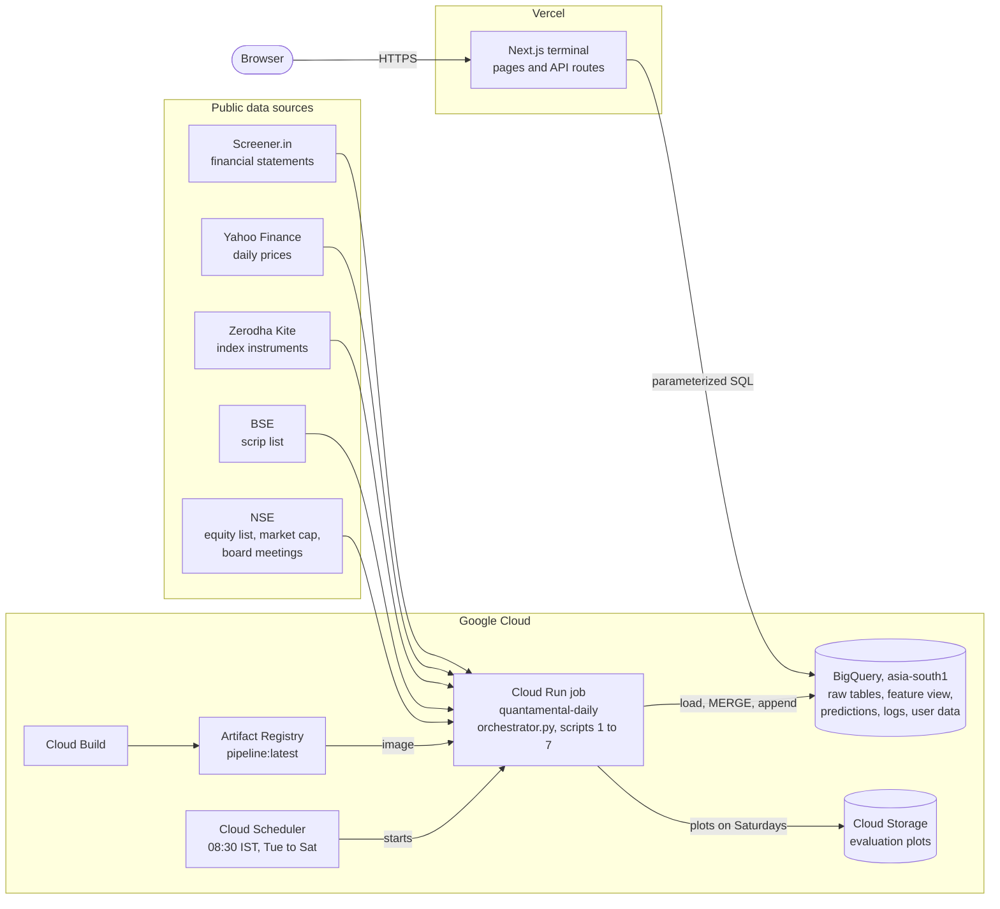

<div align="center">

# Quantamental Swing Trading Terminal

**Machine-learning forecasts for NSE-listed stocks, anchored to quarterly results and served in a web trading terminal.**

[Live demo](https://quantamental-swing-trading-private.vercel.app/) · [Architecture](#architecture) · [Getting started](#getting-started) · [Deployment](#deployment)


</div>

> **Trying the live demo:** choose **Try Demo Account** on the sign-in page. The demo account is shared, so watchlists and presets saved there are visible to other visitors.

## Contents

- [Overview](#overview)
- [Highlights](#highlights)
- [Architecture](#architecture)
- [Tech Stack](#tech-stack)
- [Repository Structure](#repository-structure)
- [Data Pipeline](#data-pipeline)
- [Machine Learning](#machine-learning)
- [BigQuery Data Model](#bigquery-data-model)
- [Trading Terminal](#trading-terminal)
- [Getting Started](#getting-started)
- [Configuration Reference](#configuration-reference)
- [Deployment](#deployment)
- [Monitoring and Operations](#monitoring-and-operations)
- [Security](#security)
- [Limitations and Roadmap](#limitations-and-roadmap)
- [Disclaimer](#disclaimer)

## Overview

This project forecasts how NSE-listed stocks trade between one quarterly results announcement and the next. "Quantamental" describes its inputs: fundamentals such as valuation, margins, growth, cash conversion and institutional ownership, combined with price signals such as trend, volatility, volume flow and relative strength.

Each results release sets an entry point, **T0**: the first trading day on or after the announcement. For every company that has reported the latest quarter, four LightGBM models estimate, relative to the T0 closing price:

- the **maximum upside** and **maximum drawdown** before the next results release,
- the **average price** over that window, and
- the **probability of a drawdown of 15% or more**.

The repository contains two applications that share one BigQuery warehouse:

| Component | Location | Runs on | What it does |
|---|---|---|---|
| **Engine** | Repository root | Cloud Run Jobs, started by Cloud Scheduler | Seven Python scripts that build the stock universe; load prices, fundamentals and results dates; evaluate the models every Saturday; and retrain and publish predictions on every run |
| **Terminal** | `frontend/` | Vercel | A Next.js app with a dashboard, screener, stock pages, watchlists and a pipeline monitor. Its server-side API routes query BigQuery |

| At a glance | |
|---|---|
| Universe | NSE-listed companies with a market cap of at least ₹1,000 crore (about 1,350–1,400) |
| History | Adjusted daily prices since January 2015, plus quarterly statements and results dates |
| Training set | About 14,500 labelled stock-quarters (June 2026) |
| Models | Four LightGBM models on 25 features: three regressors and one risk classifier |
| Schedule | 08:30 IST, Tuesday to Saturday; model evaluation on Saturdays |
| Region | All data in BigQuery `asia-south1` (Mumbai) |

## Highlights

- **Targets tied to results dates.** Labels follow each company's own results calendar instead of a fixed horizon, so every prediction maps to a real entry date and holding window.
- **Leakage controls.** Features are measured as of T0, cross-sectional ranks are lagged by one quarter, and models are validated walk-forward by quarter with a two-quarter blind test. The notebooks record the experiments behind these choices.
- **Incremental ingestion.** Prices and status logs are upserted through staging tables and `MERGE`. A stock split triggers a rebuild of that stock's price history. The fundamentals scraper skips companies whose data is recent, and new statement line items become new columns through `ALLOW_FIELD_ADDITION`.
- **Daily retraining with explanations.** Models retrain from scratch on every run. Only new or changed predictions are appended to a date-partitioned history, with per-stock SHAP values stored next to them.
- **Low-cost serverless stack.** Cloud Run Jobs, Cloud Scheduler and BigQuery, a multi-stage Docker image, and a Cloud Build step that deletes old images to stay within Artifact Registry's free storage.
- **Run logging.** Each script's status, duration and error output goes to BigQuery and appears on the terminal's monitor page.

## Architecture



**How a run works**

1. Cloud Scheduler starts the Cloud Run job at 08:30 IST, on the morning after each trading session.
2. `orchestrator.py` picks a profile from the IST weekday and runs the scripts one at a time.
3. Scripts 1 to 5 refresh the stock universe, index list, prices, fundamentals and results calendar.
4. On Saturdays, script 6 evaluates the models walk-forward and records metrics and plots.
5. Script 7 retrains the four models on the full history, predicts the current quarter, and appends changed predictions with their SHAP values.
6. The orchestrator writes one status row per script to `pipeline.execution_log`.
7. The terminal queries BigQuery when a page loads. The screener route sets `revalidate = 3600`, so its response can be cached for up to an hour.

## Tech Stack

| Layer | Technologies |
|---|---|
| Data collection | Python 3.13, requests, curl_cffi (browser impersonation for NSE), BeautifulSoup with lxml, yfinance |
| Warehouse | Google BigQuery through google-cloud-bigquery, the BigQuery Storage API and pandas-gbq |
| Machine learning | LightGBM 4.6, scikit-learn 1.9, SHAP 0.52, pandas 2.3, NumPy, SciPy |
| Evaluation output | matplotlib, seaborn, Google Cloud Storage |
| Orchestration | `orchestrator.py`, Cloud Run Jobs, Cloud Scheduler, Cloud Logging |
| Build and release | Docker (multi-stage), Cloud Build, Artifact Registry |
| Web app | Next.js 16.2 (App Router), React 19.2, TypeScript 5, CSS Modules |
| Authentication | Auth.js v5 (`next-auth` 5 beta) with the Credentials provider, JWT sessions, bcryptjs |
| Charts and icons | TradingView Lightweight Charts 5, lucide-react |
| Hosting | Vercel for the web app, Google Cloud for the pipeline and data |

## Repository Structure

```text
.
├── orchestrator.py                 # Runs the scripts in order and logs each run to BigQuery
├── 1_fetch_stocks.py               # Stock universe from NSE and BSE, ₹1,000 crore filter
├── 2_fetch_indices.py              # NSE and BSE index list from Zerodha Kite
├── 3_fetch_technicals.py           # Incremental daily prices with split detection
├── 4_fetch_fundamentals.py         # Screener.in scraper for 11 fundamentals tables
├── 5_fetch_and_clean_earnings.py   # NSE board meetings to a per-quarter results calendar
├── 6_model_train.py                # Saturday walk-forward evaluation, metrics and plots
├── 6_model_train_public.py         # Shareable copy of script 6 with the features redacted
├── 7_model_prediction.py           # Retrain, predict, upload changes, SHAP values
├── requirements.txt                # Pinned Python dependencies
├── Dockerfile, .dockerignore       # Pipeline image for Cloud Run
├── cloudbuild.yaml                 # Build, push, prune old images, update the job
├── implementation_plan.md          # Original deployment plan and free-tier estimates
├── progress.md                     # Deployment checklist
├── notebooks/                      # Training experiments and the inference notebook
└── frontend/                       # Next.js trading terminal
    ├── src/
    │   ├── app/
    │   │   ├── (dashboard)/        # dashboard, screener, stock/[symbol], watchlist, monitor
    │   │   ├── api/                # Route handlers that query BigQuery
    │   │   └── login/              # Sign-in page
    │   ├── components/             # Candlestick chart, header, sidebar
    │   ├── context/                # Dark and light theme
    │   ├── data/users.json         # Users and bcrypt password hashes
    │   ├── lib/                    # Auth.js configuration and BigQuery client
    │   └── proxy.ts                # Sends signed-out requests to /login
    ├── setup_watchlists*.js        # One-off user_data setup (destructive, see Security)
    ├── check*.js                   # Debug queries against user_data
    └── package.json
```

Scripts 6 and 7 create `data_splits/` (training, test and inference CSVs) and `saved_models/` (fitted pipelines) when they run. Those folders and the credential files (`.env`, `service-account/`, `frontend/.env.local`) are gitignored.

## Data Pipeline

`orchestrator.py` runs the scripts one after another. Each script runs as its own Python subprocess with a two-hour limit. Its output streams to the console, which is Cloud Logging on Cloud Run, and its error output is captured for the run log.

| Profile | Scripts | Used for |
|---|---|---|
| `auto` (default) | `saturday` on Saturdays (IST), `daily` on other days | Scheduled runs; this is the Docker image's default command |
| `daily` | 1, 2, 3, 4, 5, 7 | Tuesday to Friday |
| `saturday` | 1 to 7 | Saturday, adding model evaluation |
| `full` | 1 to 7 | A manual full run |
| `train` | 6 | Model evaluation only |
| `--script N` | N | A single script |

A failing script does not stop the ones after it. At the end of the run, the orchestrator writes one row per script to `pipeline.execution_log` and exits with code 1 if any script failed or timed out.

| # | Script | Source | Writes | Update method |
|---|---|---|---|---|
| 1 | `1_fetch_stocks.py` | NSE equity list and market-cap archive, BSE scrip API | `stocks.all_listed_stocks` | Replace |
| 2 | `2_fetch_indices.py` | Zerodha Kite instrument dump | `stocks.indices` | Replace |
| 3 | `3_fetch_technicals.py` | Yahoo Finance through yfinance | `technicals.daily_stock_price`, `technicals.daily_stock_price_log` | Staging table and `MERGE` |
| 4 | `4_fetch_fundamentals.py` | Screener.in | 11 `fundamentals` tables, `fundamentals.fundamentals_log` | Delete and append per batch; log by `MERGE` |
| 5 | `5_fetch_and_clean_earnings.py` | NSE corporate board-meetings API | `earnings.historical_earnings_raw`, `earnings.historical_earnings_cleaned` | Replace |
| 6 | `6_model_train.py` | Feature view | `predictions.model_metrics_log`, plots in Cloud Storage | Append |
| 7 | `7_model_prediction.py` | Feature view | `predictions.daily_inference_results`, `predictions.daily_shap_values` | Append changed rows |

Scripts 6 and 7 are covered under [Machine Learning](#machine-learning).

### 1. Stock universe

- Downloads NSE's equity master list (`EQUITY_L.csv`) and keeps ISINs that start with `INE` or `IN9`. This drops instruments such as ETFs and government securities.
- Adds BSE scrip codes by ISIN, ignoring BSE groups E, F, FC, G, IF, IT and MF. Only NSE-listed companies enter the universe.
- Reads market capitalisation from NSE's daily `PR` archive, trying today and the four days before, and keeps companies worth ₹1,000 crore or more.
- Replaces `stocks.all_listed_stocks` with the NSE symbol, company name, ISIN, listing date, BSE code, exchange flags and market cap.

If no market-cap file is found, the script uploads the full NSE list with a market cap of 0, and scripts 3 to 5 then process every NSE symbol.

### 2. Index list

Downloads Zerodha Kite's public instrument dump, keeps the NSE and BSE rows in the `INDICES` segment, and replaces `stocks.indices` (trading symbol, name, instrument token and exchange). This is reference data: no model feature or page reads it yet.

### 3. Daily prices

- Downloads daily OHLCV bars from Yahoo Finance from 1 January 2015, adjusted for splits and dividends (`auto_adjust=True`). It tries the NSE ticker (`.NS`) first and falls back to BSE (`.BO`).
- Stores one row per stock per day in `technicals.daily_stock_price`, partitioned by month and clustered by symbol. `technicals.daily_stock_price_log` records each stock's last fetched date, last close and status.
- Fetches each stock from its last stored date. If the close on that overlapping day differs from the stored close by more than 5%, the script treats it as a split or similar adjustment and replaces the stock's history with a fresh download.
- Writes in batches of up to 100,000 rows through a staging table and a `MERGE` on `symbol_date`.
- Records one status per stock: `FULL_DOWNLOAD`, `APPENDED`, `UP_TO_DATE`, `REBUILT`, `ERROR_NO_DATA` or `ERROR: <message>`.
- Creates the `technicals` dataset in `asia-south1` if needed. It also clears the dataset's default table and partition expirations on every run, because a 60-day default had been deleting the feature views.

This script computes no technical indicators. The feature view derives them in SQL from the stored bars.

### 4. Fundamentals

The script scrapes each company's Screener.in page. It uses consolidated figures, falling back to standalone figures when the consolidated statements are missing, and loads 11 tables into the `fundamentals` dataset:

| Table | Contents |
|---|---|
| `company_info` | Name, description, BSE and NSE codes, four-level sector classification |
| `key_ratios` | Headline ratios such as market cap, P/E, ROCE, ROE and dividend yield |
| `quarterly_results`, `profit_loss`, `balance_sheet`, `cash_flows`, `ratios` | Financial statements and efficiency ratios |
| `shareholding_quarterly`, `shareholding_yearly` | Promoter, FII, DII and public holdings |
| `peer_comparison` | Screener.in's peer table |
| `pros_cons` | Screener.in's listed strengths and weaknesses |

- Statement tables are transposed to one row per company and period, with one column per line item. Column names are cleaned for BigQuery, and `ALLOW_FIELD_ADDITION` turns new line items, such as bank-specific rows, into new columns. Values are stored as text.
- Every 50 companies, the script deletes those companies' existing rows and appends the new ones. `fundamentals.fundamentals_log` records the outcome for each company.
- A company is skipped when its last scrape succeeded and its newest stored quarter is at most one quarter behind the latest completed calendar quarter. Failed companies are always retried, and `--no-resume` scrapes every company.
- The script waits 0.5 seconds between companies and retries timeouts and connection errors up to three times.

```bash
python 4_fetch_fundamentals.py                        # all companies, resume on
python 4_fetch_fundamentals.py TCS INFY --no-resume   # specific companies, ignore resume
python 4_fetch_fundamentals.py --limit 100 --delay 1  # first 100 companies, slower
```

The other options are `--flush N` (batch size, default 50) and `--standalone` (standalone statements only).

### 5. Results calendar

- Uses `curl_cffi` with Chrome impersonation. It loads the NSE home page for cookies, then queries NSE's corporate board-meetings API in 90-day windows. Each window gets up to five attempts, and cookies are refreshed after a 401 or 403 response.
- Fetches from two months before the latest stored meeting; the first run starts at 1 January 2015.
- `earnings.historical_earnings_raw` keeps every results-related board meeting, without duplicates.
- `earnings.historical_earnings_cleaned` keeps the first results meeting per company per calendar quarter. A quarter with no filing gets SEBI's deadline instead (14 February, 30 May, 14 August or 14 November), and the `source` column marks those estimated rows.

NSE may block requests from cloud IP ranges. If the home-page request fails, the script writes nothing and the calendar keeps its previous contents. Running `python orchestrator.py --script 5` from a local machine brings it up to date.

## Machine Learning

### Prediction target

T0 is the first trading day on or after a company's results release for a quarter. The release date comes from `earnings.historical_earnings_cleaned`. When it is missing, the view uses SEBI's deadline: 60 days after a March quarter end and 45 days after the others. The forecast window runs from T0 to the day before the next quarter's results, or for 90 calendar days when that date isn't known yet.

| Target | Definition, relative to the T0 close | Model |
|---|---|---|
| `target_max_upside_pct` | Highest high in the window ÷ T0 close − 1 | `pipe_upside`, LightGBM regressor |
| `target_max_drawdown_pct` | Lowest low in the window ÷ T0 close − 1 | `pipe_drawdown`, LightGBM regressor |
| `target_avg_price_pct` | Average close in the window ÷ T0 close − 1 | `pipe_avg`, LightGBM regressor |
| `target_is_risky` | 1 when the maximum drawdown is −15% or worse | `pipe_risk`, LightGBM classifier with balanced class weights |

The window includes T0 itself, so upside is never below 0 and drawdown is never above 0.

### Features

The 25 features come from the BigQuery view `technicals.train_data_lagged_ranking_features`, which has one row per company and fiscal quarter. The view joins company profiles, key ratios, quarterly results, shareholding, cash flows, efficiency ratios, the results calendar and daily prices. It keeps companies that have a sector classification and a current market cap of at least ₹1,000 crore.

| Group | Features | Notes |
|---|---|---|
| Sector | `sector_l2`, `sector_l3` | Levels 2 and 3 of Screener.in's sector hierarchy, ordinal-encoded |
| Valuation and size | `historical_pe`, `historical_peg`, `historical_ps`, `historical_market_cap`, `ttm_revenue` | Trailing-twelve-month figures, priced at the T0 close |
| Profitability and quality | `op_margin_pct`, `net_profit_margin_pct`, `roce_pct`, `cfo_to_net_profit_ratio`, `cash_conversion_cycle_days` | For banks, Revenue and Financing Profit stand in for Sales and Operating Profit |
| Growth | `rev_growth_yoy`, `eps_growth_yoy` | Compared with the same quarter a year earlier |
| Ownership flows | `fii_change_qoq`, `dii_change_qoq`, `promoter_change_qoq` | Quarter-on-quarter change in holding percentage |
| Price and volume at T0 | `dist_from_200sma`, `natr_14d`, `obv_90d_slope_norm`, `return_90d` | Distance from the 200-day average, 14-day ATR ÷ price, volume-normalised 63-day OBV change, 63-day return |
| Relative ranks | `rs_90d_percentile`, `npm_sector_l2_percentile`, `rev_growth_yoy_l2_percentile`, `roce_sector_l2_percentile` | Price strength across the market, and margin, growth and ROCE within the sector. Lagged one quarter |

A rank computed within the same quarter compares a company with peers that report after its T0, which leaks future information. The production view therefore lags the ranks by one quarter. When script 7 predicts the current quarter, it also re-scores the three sector percentiles against the previous quarter's sector distribution, because only part of each sector has reported by then.

### Model pipeline

Each model is a scikit-learn `Pipeline` with two steps:

1. A `ColumnTransformer` ordinal-encodes the two sector columns, mapping unseen sectors to −1, and passes the 23 numeric features through unchanged. LightGBM handles missing values natively.
2. A LightGBM estimator with `n_estimators=200`, `learning_rate=0.05` and `random_state=42`. These values were chosen in the notebooks; no automated tuning runs.

### Weekly evaluation (script 6, Saturdays)

1. Sets aside the two most recent quarters as a blind test set.
2. Runs a walk-forward check over the last four of the remaining quarters. For each one, it trains on every earlier quarter and validates on that quarter.
3. Refits on all non-test quarters and scores the blind test set.
4. Appends 20 rows to `predictions.model_metrics_log`, each with a validation and a test score: MAE, RMSE, MSE, MAPE, WAPE and R² for each regressor, plus PR-AUC and the F1-optimal threshold for the risk model.
5. Uploads a validation-versus-test chart for the risk model, and confusion matrices at thresholds 0.45, 0.50 and 0.55, to `gs://adk-mini-project-ml-artifacts/runs/<date>/plots/`.

Script 6 saves no models. Its job is to track model quality over time, and script 7 does not use its output.

### Daily prediction (script 7)

1. Loads the feature view, labels the risky rows and re-scores the current quarter's sector percentiles.
2. Uses the latest fiscal quarter as the inference set and every earlier labelled quarter as training history.
3. Runs the same four-quarter walk-forward check and averages the F1-optimal risk thresholds across folds, using 0.45 if none can be computed.
4. Refits all four pipelines on the full history and saves them, with the threshold, to `saved_models/`. On Cloud Run that folder lives in the container and is discarded after the run.
5. Predicts every company that has reported the latest quarter and has a T0 price.
6. Compares each prediction with the latest stored one for the same company and quarter. It appends only new companies, or companies whose upside, drawdown or risk probability changed at four decimal places.
7. Computes SHAP values with `TreeExplainer` for the appended companies across all four models and appends them to `predictions.daily_shap_values`, one row per company, model and feature.

Each row of `predictions.daily_inference_results` contains:

| Columns | Meaning |
|---|---|
| `nse_symbol`, `stock_name`, `sector_l1` to `sector_l4` | Company and sector |
| `prediction_for_quarter`, `prediction_date` | Fiscal quarter covered, and run date (the partition column) |
| `board_meeting_date`, `price_on_t0_inr` | T0 date and closing price |
| `predicted_upside_pct`, `predicted_downside_pct`, `predicted_avg_pct` | Model outputs as fractions, where 0.12 means +12% |
| `predicted_upside_inr`, `predicted_downside_inr`, `predicted_avg_inr` | Price levels: T0 close × (1 + prediction) |
| `risk_probability` | Probability of a drawdown of 15% or more |
| `risk_flag_aggressive_0_45`, `risk_flag_balanced_0_50`, `risk_flag_lenient_0_55` | 1 when `risk_probability` is at least 0.45, 0.50 or 0.55 |

For example, with a T0 close of ₹1,000, outputs of 0.18, −0.07 and 0.05 give price levels of ₹1,180, ₹930 and ₹1,050. The terminal uses the balanced flag. The F1-optimal threshold from step 3 is saved with the models but doesn't set the published flags.

### Experiments

The notebooks in `notebooks/` record how the production feature set was chosen. Each run's PR-AUC for the risk model:

| Notebook | Rank features | Validation | Blind test |
|---|---|---|---|
| `6_model_training.ipynb` | Same-quarter ranks (`technicals.train_data`) | 0.5150 | 0.4799 |
| `6_model_training_leakage_features_removed.ipynb` | Removed (21 features) | 0.5112 | 0.4669 |
| `6_model_training_lagged_ranking_features.ipynb` | Lagged one quarter (**production**) | 0.5072 | 0.4801 |
| `6_model_training_asymmetric_pit.ipynb` | Asymmetric point-in-time variant | 0.4922 | 0.4183 |

Removing the ranks lowered the blind-test score. Lagging them kept it (0.4801 against 0.4799) and gave the smallest drop from validation to test, so the lagged view went to production. For scale, about a third of historical stock-quarters are labelled risky, and a model with no skill scores close to that share. Each figure comes from one run on the data available at the time. `7_model_inference.ipynb` is the notebook version of script 7.

## BigQuery Data Model

Every dataset lives in the `adk-mini-project` project, in `asia-south1`. BigQuery can't join datasets stored in different locations, so they must all stay in the same one.

| Dataset | Tables and views | Written by | Read by |
|---|---|---|---|
| `stocks` | `all_listed_stocks`, `indices` | Scripts 1 and 2 | Scripts 3 to 5, search API |
| `technicals` | `daily_stock_price` and `daily_stock_price_log`, each with a staging table. Views: `train_data_lagged_ranking_features` (production), `train_data` (baseline), `train_data_leakage_features_removed`, `train_data_asymmetric_pit` | Script 3 writes the tables; the views are defined in BigQuery | Feature view, scripts 6 and 7, stock and screener APIs |
| `fundamentals` | The 11 tables listed under [Fundamentals](#4-fundamentals), plus `fundamentals_log` and its staging table | Script 4 | Feature view, stock API |
| `earnings` | `historical_earnings_raw`, `historical_earnings_cleaned` | Script 5 | Feature view |
| `predictions` | `daily_inference_results` and `daily_shap_values`, both partitioned by `prediction_date`; `model_metrics_log` | Scripts 6 and 7 | Dashboard, screener, stock and watchlist APIs |
| `pipeline` | `execution_log` | Orchestrator | Monitor and dashboard APIs |
| `user_data` | `watchlists`, `watchlist_items`, `screener_presets` | Terminal API routes | Terminal API routes |

Prediction history is append-only, and every reader uses the latest row for each company. The SQL for the feature views is maintained in BigQuery and is not stored in this repository.

<details>
<summary>Example queries</summary>

```sql
-- Latest prediction for each company
SELECT * EXCEPT (rn)
FROM (
  SELECT *, ROW_NUMBER() OVER (PARTITION BY nse_symbol ORDER BY prediction_date DESC) AS rn
  FROM `adk-mini-project.predictions.daily_inference_results`
)
WHERE rn = 1;

-- Status of each script in the most recent pipeline run
SELECT script_order, script_name, status, duration_seconds, error_message
FROM `adk-mini-project.pipeline.execution_log`
WHERE run_id = (
  SELECT run_id
  FROM `adk-mini-project.pipeline.execution_log`
  ORDER BY run_timestamp DESC
  LIMIT 1
)
ORDER BY script_order;

-- Largest SHAP contributions to one company's latest upside forecast
SELECT feature_name, shap_value
FROM `adk-mini-project.predictions.daily_shap_values`
WHERE nse_symbol = 'TCS'
  AND model_target = 'max_upside'  -- or max_drawdown, avg_price, risk_classifier
  AND prediction_date = (
    SELECT MAX(prediction_date)
    FROM `adk-mini-project.predictions.daily_shap_values`
    WHERE nse_symbol = 'TCS'
  )
ORDER BY ABS(shap_value) DESC
LIMIT 10;

-- Weekly evaluation history
SELECT training_date, target_variable, metric_name, validation_score, test_score
FROM `adk-mini-project.predictions.model_metrics_log`
ORDER BY training_date DESC, target_variable, metric_name;
```

</details>

## Trading Terminal

The terminal in `frontend/` is a Next.js App Router application. Its pages are client components that call the app's own API routes, and those routes query BigQuery on the server.

| Page | Path | What it shows |
|---|---|---|
| Sign in | `/login` | A username and password form, and a one-click demo login |
| Dashboard | `/dashboard` | Cards for stocks analysed, stocks passing the filter, their average predicted upside and the last successful pipeline run. Below them, the top 10 picks: stocks without the balanced risk flag and with a predicted average return above 5%, ranked by that return |
| Screener | `/screener` | The latest forecast for every stock, filtered in the browser by minimum upside, minimum average return, maximum risk probability, maximum drawdown, minimum reward-to-risk (upside ÷ drawdown) and sector levels 2 and 3. The defaults are upside of at least 20%, average return of at least 5% and risk of at most 50%. Columns sort on click, values switch between percentages and ₹ levels, results export to CSV, and filters can be saved as presets for each user |
| Stock | `/stock/[symbol]` | One year of daily candles with lines for T0, maximum upside, maximum drawdown and the average target, plus the latest forecast and risk probability, the company description, P/E, ROCE, ROE and dividend yield. The stock can be added to or removed from watchlists here |
| Watchlists | `/watchlist` | Named lists for each user, which can be created, renamed and deleted. Each list shows the latest forecast for its stocks |
| Monitor | `/monitor` | Status, duration and error output for each script in the latest pipeline run |

The header has a search box that matches symbols and company names and shows the top eight results. It also has a dark and light theme switch, remembered in the browser, and a sign-out button.

<details>
<summary>API routes</summary>

| Method and path | Purpose | Session check in the route |
|---|---|---|
| `GET /api/stocks?limit=N` | Dashboard statistics and top picks | No, the proxy only |
| `GET /api/stocks/[symbol]` | One year of daily bars, the latest forecast and fundamentals for one stock | No, the proxy only |
| `GET /api/screener` | Latest forecast and latest close for every stock, with `revalidate = 3600` | No, the proxy only |
| `GET`, `POST`, `PUT`, `DELETE /api/screener/presets` | Saved screener filters for the signed-in user | Yes |
| `GET /api/search?q=` | Search by symbol or company name (at least two characters, eight results) | No, the proxy only |
| `GET /api/monitor` | Rows of the latest pipeline run | No, the proxy only |
| `GET`, `POST /api/watchlists` | List or create watchlists | Yes |
| `PUT`, `DELETE /api/watchlists/[id]` | Rename or delete a watchlist | Yes |
| `GET`, `POST`, `DELETE /api/watchlists/[id]/items` | List, add or remove stocks in a watchlist the user owns | Yes, plus an ownership check |
| `GET`, `POST`, `DELETE /api/watchlist` | Legacy single-list API, not used by the interface | Yes |
| `GET`, `POST /api/auth/[...nextauth]` | Auth.js sign-in, session and sign-out handlers | Not applicable |

User-supplied values reach BigQuery only as named query parameters.

</details>

### Authentication

- Auth.js v5 uses the Credentials provider to check usernames and bcrypt password hashes from `frontend/src/data/users.json`. Sessions are stateless JWT cookies.
- `frontend/src/proxy.ts` protects the routes. Next.js 16 renamed the `middleware` file convention to `proxy`. It redirects signed-out requests for any page or API route other than `/api/auth` to `/login`, and sends signed-in users from `/login` to `/dashboard`.
- Routes that read or change user data also call `auth()` and filter every query by the session's username.
- Each user has a role (`admin`, `user` or `demo`) stored in the session, but no code checks it yet, so every account has the same access.
- There is no sign-up page. To add an account, see [Manage users](#5-manage-users).

## Getting Started

### Prerequisites

- A Google Cloud project with BigQuery. Deployment also uses Cloud Run, Cloud Build, Artifact Registry, Cloud Scheduler and Cloud Storage.
- Python 3.13, the version in the Docker image, and Node.js 20.9 or later.
- The Google Cloud CLI (`gcloud` and `bq`).
- Credentials: either a service account key for local runs, or Application Default Credentials from `gcloud auth application-default login`.

> [!IMPORTANT]
> The project ID `adk-mini-project` is hard-coded in the Python scripts, `cloudbuild.yaml`, the frontend SQL and the helper scripts, and the plots bucket name is hard-coded in script 6. To run the project elsewhere, replace them everywhere. `git grep -n adk-mini-project` lists every occurrence.

### 1. Clone the repository

```bash
git clone https://github.com/Pushkarkv/Quantamental_SwingTrading_Strategy.git
cd Quantamental_SwingTrading_Strategy
```

### 2. Prepare BigQuery

Create all seven datasets in `asia-south1`. Scripts 3 and 5 and the orchestrator create their own datasets when missing, but the rest of the code expects the others to exist already.

```bash
for ds in stocks technicals fundamentals earnings predictions pipeline user_data; do
  bq --location=asia-south1 mk --dataset "adk-mini-project:${ds}"
done
```

If a dataset has a default table expiration, remove it, or BigQuery will delete its tables and views. Projects in the BigQuery sandbox get a 60-day default.

```bash
bq update --default_table_expiration 0 --default_partition_expiration 0 adk-mini-project:stocks
```

Create the terminal's tables. No script in the repository creates `screener_presets`; the schema below matches what the presets API reads and writes.

```sql
CREATE TABLE IF NOT EXISTS `adk-mini-project.user_data.watchlists` (
  id STRING, username STRING, name STRING, created_at TIMESTAMP
);
CREATE TABLE IF NOT EXISTS `adk-mini-project.user_data.watchlist_items` (
  watchlist_id STRING, nse_symbol STRING, added_at TIMESTAMP
);
CREATE TABLE IF NOT EXISTS `adk-mini-project.user_data.screener_presets` (
  id STRING, username STRING, name STRING, filters STRING, created_at TIMESTAMP
);
```

Finally, create the feature view `technicals.train_data_lagged_ranking_features`. Its SQL is not in this repository. Scripts 6 and 7 need one row per company and fiscal quarter, with `nse_symbol`, `Company_Name`, `sector_l1` to `sector_l4`, `parsed_period`, `t0_trading_date`, `t0_close`, the 25 features and the three `target_*_pct` columns.

### 3. Run the pipeline locally

```bash
python -m venv .venv
source .venv/bin/activate        # Windows: .venv\Scripts\activate
pip install -r requirements.txt
```

To use a service account key, keep it in `service-account/`, which is gitignored, and point to it from a `.env` file in the repository root:

```env
GOOGLE_APPLICATION_CREDENTIALS=/absolute/path/to/service-account/key.json
```

Then run the orchestrator:

```bash
python orchestrator.py                   # profile chosen from today's IST weekday
python orchestrator.py --profile daily   # scripts 1-5 and 7
python orchestrator.py --profile full    # all seven scripts
python orchestrator.py --profile train   # script 6 only
python orchestrator.py --script 3        # one script, by number
```

- The first run takes a long time. It downloads price history since 2015 for every company, scrapes every Screener.in page and builds the results calendar from 2015.
- Scripts 1 to 5 read `.env` themselves, but scripts 6 and 7 don't. Run those two through the orchestrator (for example `--script 7`), or set `GOOGLE_APPLICATION_CREDENTIALS` in your shell.

### 4. Run the terminal locally

```bash
cd frontend
npm install
```

Create `frontend/.env.local`:

```env
AUTH_SECRET=<random secret>
GOOGLE_APPLICATION_CREDENTIALS_JSON=<service account key as one line of JSON>
# Optional:
# GCP_PROJECT_ID=adk-mini-project
# AUTH_URL=http://localhost:3000
```

These commands produce the two values. The second one converts a downloaded key file to a single line:

```bash
node -e "console.log(require('crypto').randomBytes(32).toString('base64'))"
node -e "console.log(JSON.stringify(JSON.parse(require('fs').readFileSync(process.argv[1], 'utf8'))))" /path/to/key.json
```

Without `GOOGLE_APPLICATION_CREDENTIALS_JSON`, the BigQuery client falls back to Application Default Credentials.

```bash
npm run dev     # http://localhost:3000
npm run build   # production build
npm start       # serve the production build
npm run lint
```

### 5. Manage users

Accounts live in `frontend/src/data/users.json`:

```json
{ "id": "4", "username": "alice", "password": "<bcrypt hash>", "name": "Alice", "role": "user" }
```

Generate a password hash from `frontend/` after `npm install`:

```bash
node -e "console.log(require('bcryptjs').hashSync(process.argv[1], 10))" "new-password"
```

The file is bundled at build time, so changes take effect after the next deployment.

## Configuration Reference

| Variable | Used by | Required | Purpose |
|---|---|---|---|
| `GOOGLE_APPLICATION_CREDENTIALS` | Pipeline | Local runs only | Path to a service account key. Cloud Run uses the job's service account instead |
| `CLOUD_RUN_JOB` | Orchestrator | Set by Cloud Run | Runs on Cloud Run are logged with `triggered_by = scheduler`; other runs with `manual` |
| `AUTH_SECRET` (or `NEXTAUTH_SECRET`) | Terminal | Yes | Signs session tokens |
| `GOOGLE_APPLICATION_CREDENTIALS_JSON` | Terminal | Yes on Vercel | Service account key JSON as a single-line string |
| `GCP_PROJECT_ID` | Terminal | No | Project that runs the BigQuery jobs, `adk-mini-project` by default. Table names in the SQL stay hard-coded |
| `AUTH_URL` (or `NEXTAUTH_URL`) | Terminal | No | Public URL of the app. A self-hosted production server needs `AUTH_URL` or `AUTH_TRUST_HOST=true`; on Vercel, Auth.js trusts the host automatically |

<details>
<summary>Constants set in code</summary>

| Setting | Value | Where |
|---|---|---|
| Market-cap floor | ₹1,000 crore | `1_fetch_stocks.py` |
| Price history start | 1 January 2015 | `3_fetch_technicals.py` |
| Split detection | More than 5% change in the overlapping close | `3_fetch_technicals.py` |
| Price write batch | 100,000 rows | `3_fetch_technicals.py` |
| Scrape delay and batch size | 0.5 seconds; 50 companies | `4_fetch_fundamentals.py` |
| Board-meeting query window | 90 days | `5_fetch_and_clean_earnings.py` |
| Risk label | Maximum drawdown of −15% or worse | `6_model_train.py`, `7_model_prediction.py` |
| LightGBM settings | 200 trees, learning rate 0.05, seed 42 | `6_model_train.py`, `7_model_prediction.py` |
| Blind test and validation | Last 2 quarters; 4 walk-forward quarters | `6_model_train.py` |
| Risk flag thresholds | 0.45, 0.50 and 0.55 | `7_model_prediction.py` |
| Timeout per script | 7,200 seconds | `orchestrator.py` |
| Plots bucket | `adk-mini-project-ml-artifacts` | `6_model_train.py` |

</details>

## Deployment

### Pipeline on Cloud Run Jobs

The `Dockerfile` builds a two-stage `python:3.13-slim` image. The first stage compiles the Python dependencies. The final stage keeps only the runtime libraries (`libxml2`, `libxslt1.1`, `curl`, and `libgomp1` for LightGBM) and the `*.py` files. `.dockerignore` keeps notebooks, data, models, credentials and Markdown files out of the build. The default command is `python orchestrator.py --profile auto`.

`cloudbuild.yaml` builds and pushes `asia-south1-docker.pkg.dev/adk-mini-project/quantamental/pipeline:latest`, deletes older image versions, and points the `quantamental-daily` job at the new image.

One-time setup:

```bash
# 1. Docker repository
gcloud artifacts repositories create quantamental \
  --repository-format=docker --location=asia-south1

# 2. Build and push the image. On this first build the final step fails
#    because the job doesn't exist yet; the image has already been pushed.
gcloud builds submit --config=cloudbuild.yaml

# 3. Create the job
gcloud run jobs create quantamental-daily \
  --image=asia-south1-docker.pkg.dev/adk-mini-project/quantamental/pipeline:latest \
  --region=asia-south1 --memory=2Gi --cpu=1 \
  --task-timeout=7200 --max-retries=0 \
  --service-account=PIPELINE_SA_EMAIL

# 4. Allow the scheduler's service account to start the job
gcloud run jobs add-iam-policy-binding quantamental-daily \
  --region=asia-south1 \
  --member=serviceAccount:SCHEDULER_SA_EMAIL --role=roles/run.invoker

# 5. Run at 08:30 IST, Tuesday to Saturday
gcloud scheduler jobs create http quantamental-trigger \
  --location=asia-south1 \
  --schedule="30 8 * * 2-6" --time-zone="Asia/Kolkata" \
  --uri="https://run.googleapis.com/v2/projects/adk-mini-project/locations/asia-south1/jobs/quantamental-daily:run" \
  --http-method=POST \
  --oauth-service-account-email=SCHEDULER_SA_EMAIL

# 6. Test run
gcloud run jobs execute quantamental-daily --region=asia-south1
```

The schedule runs the morning after each trading session (Monday to Friday), and the orchestrator adds model evaluation on Saturdays. Google's guide to [running jobs on a schedule](https://docs.cloud.google.com/run/docs/execute/jobs-on-schedule) covers the scheduler options.

To release pipeline changes, run `gcloud builds submit --config=cloudbuild.yaml` again. No build trigger is configured, and the next scheduled run picks up the new image.

### Terminal on Vercel

1. Import the repository in Vercel and set **Root Directory** to `frontend`. Vercel detects Next.js.
2. Add `AUTH_SECRET` and `GOOGLE_APPLICATION_CREDENTIALS_JSON`, plus `GCP_PROJECT_ID` if you changed the project.
3. Deploy. Vercel rebuilds on every push to the production branch.

BigQuery runs in Mumbai, so setting the Vercel function region to `bom1` (Mumbai) shortens each query's round trip.

### Access control

| Identity | Needs to | Suggested roles |
|---|---|---|
| Pipeline job's service account | Run queries and Storage API reads, write tables, update dataset settings and upload plots | BigQuery User and BigQuery Data Editor on the project; BigQuery Data Owner on `technicals` and `earnings`, because scripts 3 and 5 reset those datasets' expiration settings on every run; Storage Object Creator on the plots bucket |
| Scheduler's service account | Start the job | Cloud Run Invoker on `quantamental-daily` |
| Cloud Build's service account | Push and prune images, and update the job | Artifact Registry Repository Administrator, Cloud Run Developer, and Service Account User on the pipeline's account |
| Terminal's service account (key stored in Vercel) | Read market and prediction data, and write user data | BigQuery Data Viewer on `stocks`, `technicals`, `fundamentals`, `predictions` and `pipeline`; BigQuery Data Editor on `user_data`; BigQuery Job User on the project |

## Monitoring and Operations

- **Logs.** Each script's output streams to Cloud Logging while it runs (`PYTHONUNBUFFERED=1`). Cloud Build also logs only to Cloud Logging.
- **Run history.** `pipeline.execution_log` holds one row per script per run, with the run ID, profile, status (`SUCCESS`, `FAILED` or `TIMEOUT`), exit code, duration, the last 2,000 characters of error output, and the trigger. The Monitor page shows the latest run.
- **Failures.** A failed script doesn't stop later scripts. The job exits with code 1 if any script failed, so Cloud Run marks the execution as failed. Retries are off (`--max-retries=0`), so start a new run with `gcloud run jobs execute`.
- **Time limits.** The orchestrator allows two hours per script, but the job's 7,200-second task timeout covers the whole run.
- **Model quality.** Every Saturday, `predictions.model_metrics_log` gets new validation and test scores, and the matching plots go to `gs://adk-mini-project-ml-artifacts/runs/<date>/plots/`.

> [!NOTE]
> Several scripts catch BigQuery or Cloud Storage upload errors, print them and still exit with code 0. `SUCCESS` means a script finished, not that every write succeeded, so check the logs when data looks stale.

| Symptom | Likely cause | Fix |
|---|---|---|
| The results calendar stops updating | NSE blocked the request from Cloud Run, so script 5 wrote nothing | Run `python orchestrator.py --script 5` locally |
| Many failed rows in `fundamentals.fundamentals_log` | Screener.in changed its page layout or is rate limiting | Check the error messages and rerun script 4 with a longer `--delay` |
| A stock stays in an `ERROR` status or has wrong prices | Bad Yahoo Finance data, or an adjustment below the 5% split threshold | Delete its row from `technicals.daily_stock_price_log`; the next run downloads its full history again |
| A run takes far longer than usual | Script 1 found no NSE market-cap file and uploaded the unfiltered universe | Rerun script 1 once NSE's archive is available |
| Scripts 6 and 7 fail with "Not found" | The feature view is missing, possibly removed by a dataset expiration | Recreate the view and clear the dataset's default expiration |
| Tables or views disappear after about 60 days | The dataset has a default table expiration | Clear it with `bq update`, as shown in [Prepare BigQuery](#2-prepare-bigquery) |

## Security

What is in place:

- `.env`, `service-account/`, key files and `frontend/.env.local` are gitignored and kept out of the Docker image. Cloud Run authenticates as the job's attached service account, so the image contains no key.
- Every user-supplied value reaches BigQuery as a named query parameter, and table names are constants.
- Passwords are stored as bcrypt hashes (cost 10). Every page and API route requires a session, user-data routes filter by username, and watchlist item routes also check ownership.

Gaps to close before wider use:

- `frontend/src/data/users.json`, which contains the password hashes, is committed. Keep the repository private, or move accounts to a database.
- The demo button signs in with a fixed password from client-side code. The demo account is shared, and anyone using it can create and delete its watchlists and presets.
- Roles are not enforced.
- Sign-in has no rate limiting or account lockout, the API routes have no rate limiting, and the app sets no security headers.
- The terminal's service account key is long-lived. Limit it to the roles listed under [Access control](#access-control) and rotate it periodically.

> [!CAUTION]
> `frontend/setup_watchlists_asia.js` deletes the whole `user_data` dataset, including saved presets, before recreating it. `frontend/setup_watchlists.js` drops the legacy `user_data.watchlist` table. Don't run either against production data.

## Limitations and Roadmap

The project is in active development.

**Known limitations**

- **Survivorship bias.** The universe is filtered on today's market cap, so the history leaves out companies that delisted or fell below ₹1,000 crore.
- **Uneven windows.** Each forecast window depends on the company's results dates, usually two to four months, and its length is not a model feature.
- **Point estimates.** The models give no prediction intervals.
- **No trading costs.** Targets assume entry at the T0 close with no slippage, gaps or fees, and there is no backtest of realised returns yet.
- **Partial labels.** The most recent quarters' windows are still open, so their labels are incomplete, and the blind test set includes them.
- **Fixed hyperparameters.** No automated search is run.
- **Fragile sources.** NSE, Screener.in and Yahoo Finance can change their formats or block requests without notice.
- **Engineering gaps.** There are no automated tests and ingestion is single-threaded. The feature view is recomputed on every read. The screener's sector lists are hard-coded, the Monitor page's "System Status" card is static text, and SHAP values are stored but not yet displayed.

**Roadmap**

- A backtest that simulates entries at T0 and measures realised returns
- Quantile models for upside and drawdown ranges
- Window length as a model feature
- A scheduled, materialised copy of the feature view, with its SQL kept in this repository
- Parallel price downloads
- Tests for split detection, delta uploads, results-date defaults and the API routes
- SHAP explanations on the stock page, and sector filters loaded from BigQuery

## Disclaimer

This project is for research and education. Its forecasts are statistical estimates from historical data, not investment advice, and they don't account for costs, liquidity or personal circumstances. The data comes from public websites whose terms of use apply, so check those terms before reusing it. Trading involves risk of loss.
